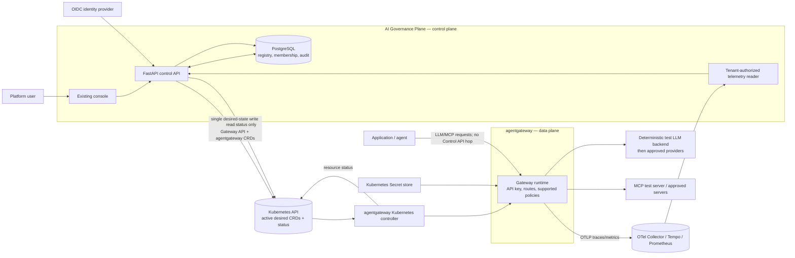
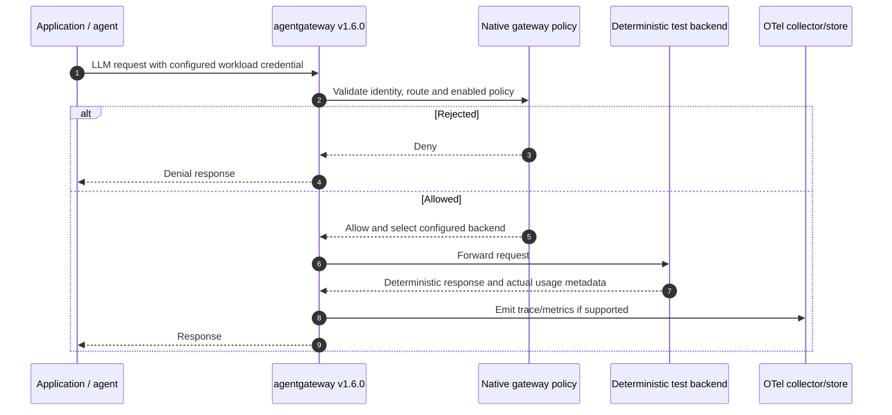

# System Overview

**Status:** Documents the implemented A–F source slice and its intended integration boundary.  
**Data-plane reference:** agentgateway OSS `v1.6.0` at commit `ea5608642b9d5c94c5baf5fd9f2f9849b808e963`.  
**Verification status:** Application, migration, Kubernetes, and telemetry paths have not been executed or verified against a live environment. Local Compose does not include agentgateway.

## Architecture boundary



**The Control API is not an inference proxy.** It manages identity-scoped resources and reads evidence; clients send LLM and MCP traffic directly to agentgateway.

## Request sequence (target)



The trace/usage branch is a requirement to prove, not an assumed integration. No model call or gateway enforcement is to be mocked away in the real-gateway integration test.

## Configuration lifecycle (target)

```mermaid
sequenceDiagram
    autonumber
    actor Admin
    participant UI as Console
    participant API as Control API
    participant Store as Platform store
    participant Kube as Kubernetes API
    participant Agw as agentgateway controller

    Admin->>UI: Submit route/model intent
    UI->>API: Versioned, tenant-authorized request
    API->>Store: Record user action and audit event
    API->>API: Validate inputs and synthesize pinned CRD shape
    API->>Kube: Create/update Gateway API and agentgateway resources
    Kube-->>API: Write accepted or error
    API-->>UI: Pending controller observation (not active success)
    Agw->>Kube: Watch desired resources
    Agw->>Agw: Reconcile runtime
    Agw->>Kube: Publish resource status/conditions
    API->>Kube: Read observed status
    alt Controller reports accepted and programmed
        API->>Store: Record observed result and audit evidence
        API-->>UI: Observed active
    else Rejected, stale, or unavailable
        API->>Store: Record explicit failure/pending evidence
        API-->>UI: Failed or still pending; retain diagnostic correlation
    end
```

Status names in this diagram are conceptual until mapped to the exact v1.6.0 resource conditions. A write acknowledgement is not an observation. This path deliberately excludes a second GitOps writer and the existing unverified direct `/config/apply` HTTP assumption.

## Ownership summary

| Concern | Owner |
|---|---|
| User credentials and primary identity | Configured generic OIDC provider |
| Tenant membership and platform roles | Control-plane database |
| Logical gateway desired state | Platform API; active desired resources stored as Kubernetes Gateway API/agentgateway CRDs |
| Runtime reconciliation and observed resource status | agentgateway controller, surfaced through Kubernetes resource status |
| Provider secrets | Kubernetes Secret store; platform keeps references |
| Audit events | Control-plane database with hash-chain records |
| Request usage/traces | OTel Collector, Tempo and Prometheus are configured; gateway usage is not yet verified |
| Approval decisions | Deferred; not mounted in the active API |

## Current workspace surfaces and limits

The active API surfaces are implemented in source but are not proof of production behavior:

| Existing router prefix | Operations observed in source | Current limitation observed |
|---|---|---|
| `/api/v1/auth` | OIDC-backed identity and development-only local login | Provider configuration and identity lifecycle are unverified. |
| `/api/v1/tenants` | Tenant membership administration | Authorization and database integration tests are present but unrun. |
| `/api/v1/applications` | Persistent application registry, key issue/status/revoke | Kubernetes key catalog updates and gateway runtime acceptance are unverified. |
| `/api/v1/models` | Persistent model/backend registry | Provider secrets are references; no inference request is proxied by this API. |
| `/api/v1/routes` | Validate, synthesize, apply and read observed Kubernetes resources | CRD compatibility and live controller status have not been verified. |
| `/api/v1/audit` | Tenant-scoped audit evidence | Persistence and chain verification have not been tested in this handoff. |
| `/api/v1/observability` | Tempo traces and configured Prometheus metrics | Gateway request/token metrics are explicit unavailable values unless configured and emitted. |

MCP, approvals, onboarding, FinOps, and automated drift routers are not mounted.
The Kubernetes client no longer calls a direct `/config/apply` endpoint, and a
Kubernetes write acknowledgement alone is not reported as controller-observed
active state.

## Source and status references

- The pinned source, lab source files and OSS/Enterprise distinctions are recorded in [source-inventory.md](../references/source-inventory.md).
- Feature-level evidence, adaptation needs and verification state are recorded in [feature-source-matrix.md](../references/feature-source-matrix.md).
- Stable identifiers F-001 through F-013 are retained from the wireframe coverage matrix; see [MVP scope](mvp-scope.md) for the active implementation subset and deferred work.
- Tests have not been executed. See [test traceability](../features/test-traceability.md) for coverage mapped to current test files.
