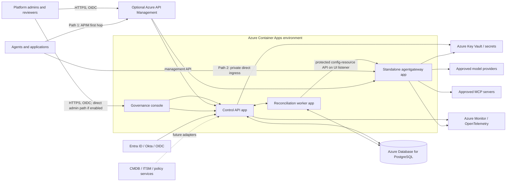

# System Overview

**Target deployment:** Azure Container Apps (ACA), with standalone agentgateway as a separate ACA app.
**Runtime boundary:** the Governance Plane manages enterprise configuration and evidence; agentgateway handles agent traffic. Inference never passes through the Plane API.
**Transition status:** this document describes the selected target. The current application still has Kubernetes-specific gateway translation and reconciliation code; that path must be replaced before an ACA-only deployment can provision routes, keys, or report gateway observations. No ACA deployment has been validated.

## System context



The Governance Plane and gateway should use separate ACA apps and managed identities. The gateway receives agent requests and calls approved model/MCP destinations. The Plane handles user/API management requests, persists desired state and audit records in PostgreSQL, and publishes supported changes through a protected config-resource API exposed on a UI-enabled gateway listener. The unauthenticated admin listener stays loopback-only. Entra/Okta user sign-in is separate from ACA managed identity, which authenticates workloads to Azure resources.

## Entry and exit points

For ACA, app ingress `internal` restricts access to callers inside the same Container Apps environment. To allow APIM or approved private callers from the VNet, use an internal-only ACA environment and app ingress `external`; in that environment the app is exposed to the VNet through its internal load balancer, not the public internet. The deployment script checks this before choosing external app ingress for the Control API.

| Flow | Entry | Exit | Boundary |
|---|---|---|---|
| Governance users | APIM or secured ACA ingress to the console/API | PostgreSQL, configured OIDC/JWKS endpoints, Key Vault, telemetry, and the protected gateway config-resource API | OIDC users are authorized by the Plane's tenant membership model. The Plane API is not an inference proxy. |
| Agent traffic through APIM | Agent → APIM | APIM → private gateway ingress → approved model/MCP service | APIM is optional. It adds edge controls; the gateway remains the runtime policy/enforcement point. |
| Direct private agent traffic | Approved private workload → private gateway ingress | Gateway → approved model/MCP service | Direct ingress must enforce the same minimum gateway identity and policy baseline as the APIM path. |
| Reconciliation | Plane worker reads durable desired state from PostgreSQL | Protected config-resource API on a UI-enabled gateway listener | This is the target ACA integration. The current worker uses Kubernetes and must be replaced. |
| Operations | Operators access Azure control plane, logs, and alerts | ACA, PostgreSQL, Key Vault, APIM, agentgateway, and model-provider diagnostics | Azure Monitor evidence and gateway request evidence must remain distinguishable. |

Do not expose agentgateway's unauthenticated admin endpoint through the agent ingress or to the worker; keep it bound to loopback. If the worker publishes through the config-resource API, expose that API on a UI-enabled listener protected by a programmatic policy (for example JWT or API key) and network restrictions. Protect the Plane API with its own authentication design; private networking alone is not authorization.

## Desired configuration lifecycle

```mermaid
sequenceDiagram
    autonumber
    actor Owner as Agent owner / reviewer
    participant API as Governance Control API
    participant DB as Plane PostgreSQL
    participant Worker as ACA reconciliation worker
    participant GW as Protected agentgateway config-resource API
    participant Runtime as Agentgateway runtime

    Owner->>API: Submit tenant-scoped model/route/key/policy intent
    API->>API: Authenticate, authorize, validate and check approval
    API->>DB: Persist versioned desired state and audit event
    API-->>Owner: Return desired revision (not runtime-active)
    Worker->>DB: Claim pending revision
    Worker->>GW: Publish supported configuration through protected config-resource API
    GW->>GW: Validate and persist configuration; reload runtime
    Worker->>GW: Read effective configuration and runtime health
    Worker->>DB: Record published/observed evidence for that revision
```

The repository currently writes Kubernetes resources synchronously and reads controller conditions. Replace that with a durable outbox/claim model, a protected config-resource API client, runtime configuration validation, and explicit observed-state handling. Do not reuse Kubernetes `Accepted` / `ResolvedRefs` semantics for standalone mode. A successful HTTP write means only **submitted**; report **observed** only after the target returns the corresponding revision/configuration evidence. A representative request is required before claiming **runtime verified**.

## Configuration ownership

| Concern | Owner |
|---|---|
| Human login and claims | Enterprise OIDC provider (Entra, Okta, or other configured issuer) |
| Tenant authorization and platform roles | Governance Plane PostgreSQL, keyed by issuer, subject, and tenant |
| Governance intent, approvals, revisions, audit | Governance Plane PostgreSQL |
| Active gateway configuration and runtime decisions | Standalone agentgateway configuration store and runtime |
| Cloud workload identity | Separate ACA managed identities for API, worker, and gateway; use least privilege |
| Azure secrets | Key Vault; the Plane stores secret references. Azure provider access can use the gateway's managed identity where the selected provider supports it. |
| CMDB, ITSM, OpenFGA, OPA | Their respective systems remain authoritative for their records/decisions; adapters are not currently implemented. |
| Request logs and traces | Gateway/ACA telemetry destinations; do not infer runtime usage from Plane audit events. |

Keep the Plane database distinct from agentgateway's configuration database/schema. The worker should use agentgateway's supported config-resource API and must not write directly into agentgateway-owned tables. Pin an agentgateway release and verify the standalone API contract and supported resource kinds against that release.

## Ingress paths

1. **APIM path:** `Agent → APIM → private agentgateway ingress → approved model/MCP backend`.
2. **Direct private path:** `Approved private agent → private agentgateway ingress → the same approved backend set`.

Both paths must arrive at the same gateway configuration and minimum request-time policy baseline. APIM may add edge authentication, rate limits, and analytics; it does not replace gateway-side checks. Establish a trusted identity contract across APIM and gateway, strip spoofable identity headers, and correlate request IDs across both layers. Do not permit either path to reach managed backends directly.

## Migration boundary from this repository

The current runtime integration is not ACA-compatible yet:

- `integrations/agentgateway/translator.py` generates `HTTPRoute`, `AgentgatewayBackend`, and `AgentgatewayPolicy` Kubernetes objects.
- `integrations/agentgateway/client.py` loads in-cluster credentials or kubeconfig and applies Kubernetes resources.
- The reconciliation worker reads Kubernetes controller status.
- Application key catalogs use Kubernetes ConfigMaps/Secrets.
- Checked-in deployment assets under `deploy/kubernetes/` install the Plane and its Kubernetes RBAC, not an ACA environment.

The repository now includes an initial Bicep package for the API and worker apps in an existing ACA environment. It does not provision networking, PostgreSQL, standalone agentgateway, or a migration job. The target still needs a secure standalone config-resource access path, a release-pinned standalone translator/client, runtime secret handling, and a durable reconciliation outbox with retry/lease semantics. Until those exist and are validated, deploying the Plane apps to ACA does **not** complete the gateway integration.

Agentgateway's standalone admin API has no authentication and defaults to loopback. Keep it there. The config-resource API is also served on gateways listed under `ui.gateways`; the UI policy can use programmatic JWT, basic, or API-key authentication. The Plane still needs an implemented credential/token flow, a dedicated UI listener, and verified API authorization before service publishing is enabled. Network isolation alone must not be documented as authorization.

## Existing feature boundaries retained

MCP discovery is a management-plane call to exact allowlisted HTTPS hosts. MCP policy records are not currently published/enforced at runtime. Budgets are advisory; hard caps are not claimed. Operations observations are read-only. Approval records only gate workflows explicitly wired to consume them. CMDB, ITSM, APIM, external policy engines, production OIDC configuration, and gateway telemetry require environment-specific integration and validation.
