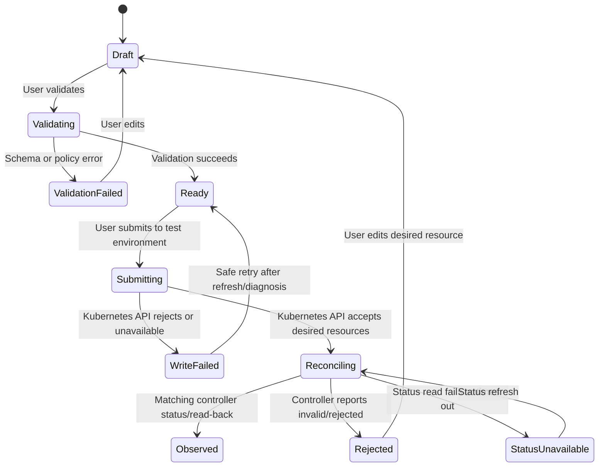

# Interaction Contracts and Lifecycle States

**Phase:** 2 — Gate 2-approved design baseline  
**Status:** Contracts describe source-level API behavior and required UI semantics. Runtime integration remains unverified; active endpoints and limitations are identified in [screen specifications](./screen-specifications.md).

## 1. Desired-configuration lifecycle

The UI distinguishes platform intent, Kubernetes write acknowledgement, and controller observation. It does not equate a successful API call with an active runtime.



`Observed` must be bound to the resource identity and desired revision that was submitted. A stale status for an earlier resource version does not satisfy the transition. Production application activation requires a separate matching approval. Route rollback restores a checksummed snapshot and submits it through the same Kubernetes path; it does not guarantee recovery. Quorum is not implemented.

| State | User-facing meaning | Required evidence |
|---|---|---|
| `draft` | Local/platform edit; not applied | Current editable values and draft identifier |
| `validating` | Input and generated-resource checks are running | Validation request in progress |
| `validation_failed` | No write was attempted | Field-level and/or schema diagnostic |
| `ready` | Validation passed; waiting for explicit submit | Validation result tied to draft version |
| `submitting` | Platform is writing desired Gateway API/agentgateway resources to Kubernetes | Request/correlation ID |
| `write_failed` | Kubernetes API rejected the write or was unavailable | Explicit API error; no success state |
| `reconciling` | Desired resource was accepted; controller observation is pending | Resource identity/version and last observed time |
| `observed` | Controller status/read-back matches the requested revision | Actual controller conditions for the exact resource |
| `rejected` | Controller reports the requested resource is invalid/unprogrammed | Controller diagnostic with secret-safe rendering |
| `status_unavailable` | Runtime status could not be read | Source, last successful observation, retry affordance |

## 2. Request/response UX shapes

### Validation request (proposed)

```json
{
  "draft_id": "draft-example",
  "expected_revision": 3,
  "route": {
    "name": "test-chat",
    "path_prefix": "/v1/chat/completions",
    "backend_ref": "approved-backend"
  },
  "policy": {
    "prompt_guard_profile": "approved-regex-profile"
  }
}
```

The source API accepts route contracts, but exact schema compatibility still requires verification against the pinned agentgateway CRDs. The interface must not let the client set authoritative tenant ownership. Unsupported fields fail validation; they are never ignored silently.

### Validation response (proposed)

```json
{
  "status": "validated",
  "draft_id": "draft-example",
  "expected_revision": 3,
  "resource_preview": [
    {"api_version": "gateway.networking.k8s.io/...", "kind": "HTTPRoute"},
    {"api_version": "agentgateway.dev/...", "kind": "AgentgatewayPolicy"}
  ],
  "warnings": [],
  "correlation_id": "request-example"
}
```

On validation failure, return/render `status: "invalid"` with safe field diagnostics and a correlation ID. Preview metadata is not proof that resources were written or accepted.

### Submission response (proposed)

```json
{
  "status": "reconciling",
  "resource_refs": [
    {"kind": "HTTPRoute", "namespace": "test", "name": "test-chat"}
  ],
  "submitted_revision": 4,
  "correlation_id": "request-example"
}
```

This response means only that the Kubernetes API accepted the write. The console must display **Pending controller observation**, then query the exact resource status. Only verified matching status can change the display to **Observed active**.

### Error presentation contract (proposed)

```json
{
  "error": {
    "code": "RESOURCE_REJECTED",
    "message": "The controller rejected this resource.",
    "field_errors": [],
    "correlation_id": "request-example"
  }
}
```

The UI preserves safe user input, shows the correlation ID, and provides a safe next step. It does not display stack traces, secrets, full upstream response bodies, or inferred success. Exact envelope details follow the mounted API implementation and still require runtime/client compatibility verification.

## 3. Tenant and role contract

- The server derives the effective tenant and roles from the validated identity and membership store.
- Any user-selected tenant context must be checked against that membership before every read/write.
- UI role filtering is presentational only; authorization is enforced on the server.
- A missing/invalid identity, unavailable membership source, or cross-tenant resource reference fails closed.
- Cross-tenant resource existence must not be disclosed in errors.

## 4. Application, model and secret interactions

- Application creation uses the authenticated tenant context and returns a stable resource identifier and explicit lifecycle status.
- Eligible development/staging credential material is returned once over the authenticated creation response and never regenerated as a success-shaped fallback. Production activation requires a matching, approved, unused request and returns the provisioned credential once. The UI warns before revealing a credential and never writes it to local storage or logs.
- The catalog stores provider/model identifiers and Kubernetes Secret references, not plaintext provider keys.
- A Secret reference is not labeled “valid” or “healthy” unless the backend actually verifies existence/access and returns evidence.
- Onboarding records the requested token quota; actual quota enforcement is not established. FinOps budgets are advisory; hard caps are rejected/unavailable.

## 5. MCP discovery and policy contract

- Discovery uses actual MCP responses, requires HTTPS and an exact configured host allowlist, and disables redirects. Operator egress controls are still required.
- Discovery timeout, transport failure, malformed result, or policy error is explicit; it never returns sample tools as if discovered.
- Per-tool CEL policy records are persisted as intent only and explicitly report `not_published_to_gateway`. No allowed/denied tool-call test path is implemented.
- Authorization of `tools/call` and visibility/filtering of `tools/list` are separate contracts. The UI does not promise hidden-tool behavior until the pinned OSS implementation passes that acceptance test.
- Discovery currently has no authenticated MCP transport or pagination, and uses the configured protocol version; compatibility remains unverified.

## 6. Traces, audit and status interactions

- Traces are tenant/application-scoped and sourced from a connected telemetry backend. Missing fields remain unavailable, not zero.
- Audit records represent management events in the database-backed hash chain. The implementation is not a compliance ledger; signing/export and retention guarantees are not established.
- Runtime state and operations drift are read from Kubernetes API/controller status. The operations drift endpoint makes no writes; unavailability must not be shown as healthy.
- Policy revision history and rollback are available in source. Rollback writes desired state through the Kubernetes path; live behavior is unverified.
- Approval records support decisions with separation of duties; only matching production application activation consumes them. Other approval types do not trigger generic mutations.
- Budgets show configured advisory thresholds and observed spend only if the tenant-scoped Prometheus query returns data. No force-reconcile, automatic remediation, or hard-cap behavior is available.

## 7. Concurrency, retries and idempotency

- Revision/ETag concurrency tokens and stable idempotency keys are not consistently implemented; clients must not imply that arbitrary retries are safe.
- On conflict, return a conflict state and require refresh/review; do not overwrite another administrator's newer change.
- A timeout after submission is **outcome unknown/pending**, not failed or successful until the relevant resource state is read back.
- Any timeout after submission is **outcome unknown/pending**, not failed or successful until the resource status is read back.
