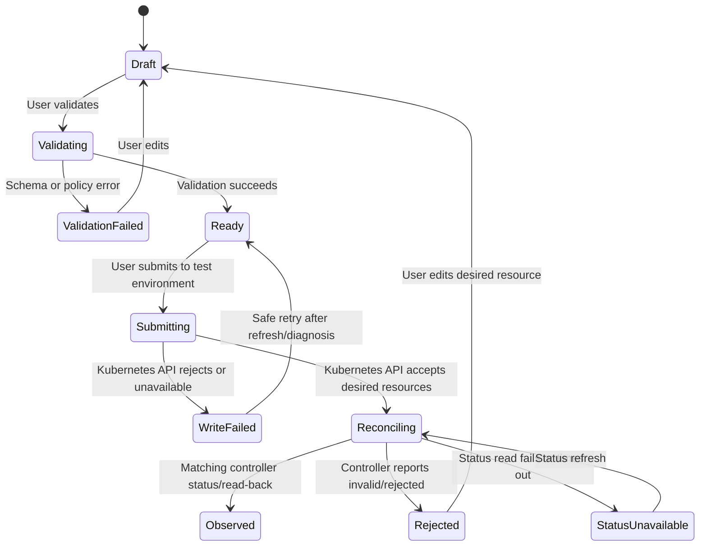

# Interaction Contracts and Lifecycle States

**Phase:** 2 — Gate 2-approved design baseline  
**Status:** These remain UX-facing target contracts, not a claim that every transition is implemented. Active endpoints and limitations are identified in [screen specifications](./screen-specifications.md).

## 1. Desired-configuration lifecycle

The UI distinguishes platform intent, Kubernetes write acknowledgement, and controller observation. It does not equate a successful API call with an active runtime.



`Observed` must be bound to the resource identity and desired revision that was submitted. A stale status for an earlier resource version does not satisfy the transition. Production approval, quorum, and rollback are not part of this MVP state machine.

| State | User-facing meaning | Required evidence |
|---|---|---|
| `draft` | Local/platform edit; not applied | Current editable values and draft identifier |
| `validating` | Input and generated-resource checks are running | Validation request in progress |
| `validation_failed` | No write was attempted | Field-level and/or schema diagnostic |
| `ready` | Validation passed; waiting for explicit submit | Validation result tied to draft version |
| `submitting` | Platform is writing desired Gateway API/agentgateway resources to Kubernetes | Request/correlation ID |
| `write_failed` | Kubernetes API rejected the write or was unavailable | Explicit API error; no success state |
| `reconciling` | Desired resource was accepted; controller observation is pending | Resource identity/version and last observed time |
| `observed` | Controller status/read-back matches the requested revision | Actual controller conditions for the exact resource |
| `rejected` | Controller reports the requested resource is invalid/unprogrammed | Controller diagnostic with secret-safe rendering |
| `status_unavailable` | Runtime status could not be read | Source, last successful observation, retry affordance |

## 2. Request/response UX shapes

### Validation request (proposed)

```json
{
  "draft_id": "draft-example",
  "expected_revision": 3,
  "route": {
    "name": "test-chat",
    "path_prefix": "/v1/chat/completions",
    "backend_ref": "approved-backend"
  },
  "policy": {
    "prompt_guard_profile": "approved-regex-profile"
  }
}
```

The exact fields and schema are pending implementation-level verification against the pinned agentgateway CRDs. The interface must not let the client set authoritative tenant ownership. Unsupported fields fail validation; they are never ignored silently.

### Validation response (proposed)

```json
{
  "status": "validated",
  "draft_id": "draft-example",
  "expected_revision": 3,
  "resource_preview": [
    {"api_version": "gateway.networking.k8s.io/...", "kind": "HTTPRoute"},
    {"api_version": "agentgateway.dev/...", "kind": "AgentgatewayPolicy"}
  ],
  "warnings": [],
  "correlation_id": "request-example"
}
```

On validation failure, return/render `status: "invalid"` with safe field diagnostics and a correlation ID. Preview metadata is not proof that resources were written or accepted.

### Submission response (proposed)

```json
{
  "status": "reconciling",
  "resource_refs": [
    {"kind": "HTTPRoute", "namespace": "test", "name": "test-chat"}
  ],
  "submitted_revision": 4,
  "correlation_id": "request-example"
}
```

This response means only that the Kubernetes API accepted the write. The console must display **Pending controller observation**, then query the exact resource status. Only verified matching status can change the display to **Observed active**.

### Error presentation contract (proposed)

```json
{
  "error": {
    "code": "RESOURCE_REJECTED",
    "message": "The controller rejected this resource.",
    "field_errors": [],
    "correlation_id": "request-example"
  }
}
```

The UI preserves safe user input, shows the correlation ID, and provides a safe next step. It does not display stack traces, secrets, full upstream response bodies, or inferred success. Exact API envelope/versioning remains an implementation contract to verify before coding.

## 3. Tenant and role contract

- The server derives the effective tenant and roles from the validated identity and membership store.
- Any user-selected tenant context must be checked against that membership before every read/write.
- UI role filtering is presentational only; authorization is enforced on the server.
- A missing/invalid identity, unavailable membership source, or cross-tenant resource reference fails closed.
- Cross-tenant resource existence must not be disclosed in errors.

## 4. Application, model and secret interactions

- Application creation uses the authenticated tenant context and returns a stable resource identifier and explicit lifecycle status.
- Eligible development/staging credential material is returned once over the authenticated creation response and never regenerated as a success-shaped fallback. Production applications remain drafts without credentials until an approval workflow exists. The UI warns before revealing a credential and never writes it to local storage or logs.
- The catalog stores provider/model identifiers and Kubernetes Secret references, not plaintext provider keys.
- A Secret reference is not labeled “valid” or “healthy” unless the backend actually verifies existence/access and returns evidence.
- Usage quotas, virtual-key budgets and hard caps are omitted from the MVP interactions.

## 5. MCP discovery and invocation contract (deferred)

- Discovery displays server identity, result timestamp, tool names, and a source/correlation ID from an actual MCP response.
- Discovery timeout, transport failure, malformed result, or policy error is explicit; it never returns sample tools as if discovered.
- Allowed and denied test calls traverse the pinned agentgateway deployment. Test evidence must demonstrate whether the request reached the MCP server.
- Authorization of `tools/call` and visibility/filtering of `tools/list` are separate contracts. The UI does not promise hidden-tool behavior until the pinned OSS implementation passes that acceptance test.
- Protect endpoint registration against unsafe network destinations, including unauthorized local/private addresses, according to the approved deployment policy.

## 6. Traces, audit and status interactions

- Traces are tenant/application-scoped and sourced from a connected telemetry backend. Missing fields remain unavailable, not zero.
- Audit records represent management events in the database-backed hash chain. The implementation is not a compliance ledger; signing/export and retention guarantees are not established.
- Runtime state is read from the Kubernetes API/controller status for the managed resources. If status is stale or unavailable, show that condition and last observation time.
- There is no force-reconcile, rollback, policy-approval, cost, or budget interaction in the approved MVP.

## 7. Concurrency, retries and idempotency

- Mutations carry a resource revision/ETag or equivalent optimistic concurrency token once that API contract is implemented.
- On conflict, return a conflict state and require refresh/review; do not overwrite another administrator's newer change.
- Retry is safe only for an idempotent operation with a stable request/idempotency key. The UI communicates whether a previous write outcome is unknown before allowing a retry.
- Any timeout after submission is **outcome unknown/pending**, not failed or successful until the resource status is read back.
