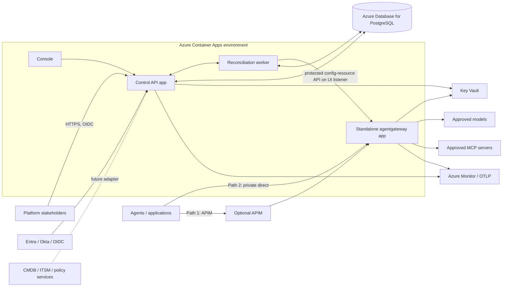
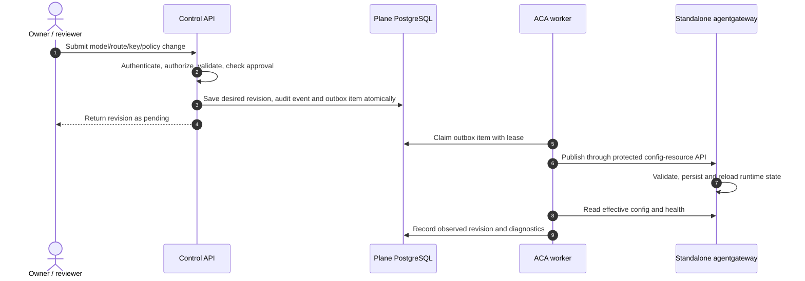

# AI Governance Plane Architecture

**Decision:** Azure Container Apps for the Governance Plane and standalone agentgateway. AKS and Kubernetes are not deployment dependencies in the target design.
**Product boundary:** the Plane owns enterprise governance, desired state, approvals, and evidence; agentgateway owns the agent request path and supported runtime enforcement.
**Current source gap:** gateway translation, key provisioning, apply, and status readback still use Kubernetes. The architecture below is the target; the ACA/standalone integration is not yet implemented or verified.

## 1. Architecture



The Control API does not receive, proxy, or make synchronous inference calls. The worker uses durable desired state to publish through a protected standalone config-resource API on a UI-enabled listener. The unauthenticated admin API stays loopback-only. Do not let the worker write directly into agentgateway-owned database tables.

## 2. Deployment responsibilities and trust boundaries

| Component | Boundary and responsibility |
|---|---|
| Control API/console | Authenticated management ingress; validates OIDC identity, tenant membership, request authorization, approvals, and governance data |
| Reconciliation worker | Internal ACA app; one replica until the code has an atomic DB lease/claim; only app allowed to publish gateway configuration |
| Standalone agentgateway | Separate ACA app with agent traffic ingress and a separately protected config-resource API listener; owns active runtime configuration and request-time behavior |
| Plane PostgreSQL | Plane-owned desired state, tenant/membership records, approvals, audit and reconciliation outbox |
| Key Vault | Source of provider and app secrets; store references in Plane records, not plaintext |
| ACA managed identities | Separate API, worker and gateway workload identities; least privilege to Azure resources |
| APIM | Optional first hop for enterprise edge controls; not a replacement for gateway runtime policy |

Use Azure Database for PostgreSQL Flexible Server with private networking. Keep the standalone gateway admin API bound to loopback; it has no authentication and must not be exposed to the worker or public ingress. The supported config-resource API can be served on a UI-enabled listener; `ui.policies` supports programmatic JWT, basic, or API-key authentication in addition to browser OIDC. Protect a dedicated management listener with authentication policy and network restrictions, and implement the worker credential/token flow before allowing writes. This authenticated publishing flow is not implemented yet. Enable external agent traffic only for selected paths. A private network location is not a substitute for identity and authorization.

Human identities authenticate to the Plane through configured OIDC (for example Entra or Okta). ACA managed identity is a workload identity for service-to-service access; it is not the user's SSO token. The gateway can use its own ACA managed identity for Azure OpenAI where supported by the selected agentgateway release. These identity flows are separate.

For ACA networking, set the environment to internal-only when APIM and direct callers must use private VNet connectivity. In that environment, app ingress must be `external` for callers outside the ACA environment to reach it; app ingress `internal` permits only same-environment callers. The `external` app setting does not expose an app to the public internet when the managed environment itself is internal. The deployment script checks this distinction for the Plane API.

## 3. Traffic entry and exit points

**Governance entry:** stakeholder → optional APIM → Control API/console.

**Runtime path 1:** agent → APIM → private standalone agentgateway → approved model/MCP backend.

**Runtime path 2:** approved private agent → standalone agentgateway → the same approved backend set.

**Management exit:** API/worker → PostgreSQL, Key Vault, OIDC discovery/JWKS, and configured telemetry endpoints; the worker publishes to the protected config-resource API on a UI-enabled gateway listener.

**Runtime exits:** agentgateway → allowlisted model-provider and MCP endpoints. Deny direct client-to-backend paths. Use network egress controls as well as application-level allowlists.

Path 2 is optional. Both paths share gateway-side authentication, authorization, routing, and supported AI/MCP policies. If APIM forwards identity claims, it must strip spoofable caller headers and establish a documented gateway-facing identity contract. Correlate request IDs across APIM, agentgateway, and backends.

## 4. Configuration management and lifecycle

The Governance Plane PostgreSQL database is the source of record for governance intent and workflow history. The active runtime configuration is owned by standalone agentgateway. A versioned worker publishes supported resources through agentgateway's protected config-resource API and reads back effective configuration/health. It does not edit agentgateway database tables or expose the unauthenticated loopback admin API.



Use explicit lifecycle states: `draft` → `approved` (where required) → `pending` → `submitted` → `observed` → `runtime_verified`. A config-resource API 2xx response means submitted only. Readback must be tied to the same desired revision. Runtime verification needs a representative request through the traffic ingress. Keep retries idempotent, leased, bounded, and auditable. Do not report standalone observations using Kubernetes controller condition terminology.

### Current transition gap

The code still emits `HTTPRoute`, `AgentgatewayBackend`, and `AgentgatewayPolicy` CRDs; writes via the Kubernetes API; stores app key catalogs as ConfigMaps; and reads Kubernetes status. Remove or isolate that path from the ACA target and add a release-pinned standalone adapter, native resource mappings, a supported key lifecycle, runtime validation/readback, and durable outbox worker before calling this architecture implemented. See the [system overview](../ai-platform/docs/architecture/system-overview.md) and [MVP cutover list](../ai-platform/docs/architecture/mvp-scope.md).

## 5. Sources of record and policy layers

| Information | Source of record | Plane role |
|---|---|---|
| Human identity | Entra, Okta, or selected OIDC provider | Verify issuer, audience, signature and stable subject |
| Tenant access | Plane authorization store unless an explicit external authorization adapter is selected | Resolve `(issuer, subject, tenant)` memberships; never trust client role claims or tenant headers alone |
| Agent/application ownership and lifecycle | CMDB/agent inventory where enterprise policy requires it | Store external IDs and a governed projection; CMDB adapter remains future work |
| Change ticket and approvals | ITSM for enterprise change process; Plane approval ledger for built-in workflows | Link ticket/evidence IDs; block protected changes until required approval is proven |
| Gateway runtime configuration | Standalone agentgateway active config | Publish via protected config-resource API; read back active/effective state |
| Provider and app credentials | Key Vault or selected enterprise secret store | Persist references only; gateway must retrieve credentials securely |
| Azure resource compliance | Azure Policy | Deployment/resource compliance, not a per-request decision |
| Relationships | OpenFGA if selected | Use an explicit management or runtime decision contract |
| General policy decisions | OPA if selected | Define caller, decision input/output, timeout, and fail behavior |
| Runtime requests and usage | agentgateway and configured telemetry system | Keep observed usage separate from governance audit and inferred values |

Policy engines are selected/configured per environment, but not interchangeable. Azure Policy governs Azure resources; OpenFGA evaluates relationships; OPA evaluates policy decisions; agentgateway policies enforce supported request-time controls; APIM governs its edge hop. Never translate arbitrary policy text between engines and claim semantic equivalence. In this source, MCP per-tool policies are not published/enforced and budget thresholds are advisory.

## 6. Environment configuration

Use deployment settings only for bootstrap values: database connection or token-auth setup, OIDC issuer/audience, ACA service endpoints, telemetry endpoints, and Key Vault references. Use typed environment/integration records for multiple IdPs, CMDB/ITSM sources, and policy engines. Do not use flat environment variables as a durable registry.

Target environment record (not currently persisted by the app):

```yaml
environmentId: prod-us
deployment: azure-container-apps
gateway:
  mode: standalone
  release: v1.6.0 # compatibility target; pin to a verified image
  trafficIngress: private
  managementEndpointRef: aca/agentgateway-private
identityProviders:
  - issuer: https://login.microsoftonline.com/<tenant-id>/v2.0
    audience: ai-governance-api
    clientId: ai-governance-control-api
    jwksRef: oidc/entra
integrations:
  postgresRef: database/governance-prod
  keyVaultRef: secrets/platform-vault
  apimRef: apim/enterprise-edge # optional
  policyEngines: []
telemetry:
  otlpEndpointRef: telemetry/azure-monitor
```

Never put plaintext secrets in this record. Resolve `*Ref` values through authorized deployment/runtime identities.

## 7. Release and verification gates

The upstream Azure guide confirms standalone agentgateway can run as an ACA app and use the attached managed identity for Azure OpenAI. Its examples also require supplying a real config file and protecting the gateway ingress. This does not establish that this Governance Plane can manage that runtime.

Before production use, pin the agentgateway release; verify the standalone resource API/schema; validate the private management auth boundary; implement and test model, route, policy and key publication; validate deletion/revocation and retry behavior; execute PostgreSQL migrations; prove APIM and direct-private paths against the same runtime baseline; and run a real request to a deterministic backend. Record gateway and Plane evidence independently. Until then, ACA deployment and runtime enforcement are unverified.
