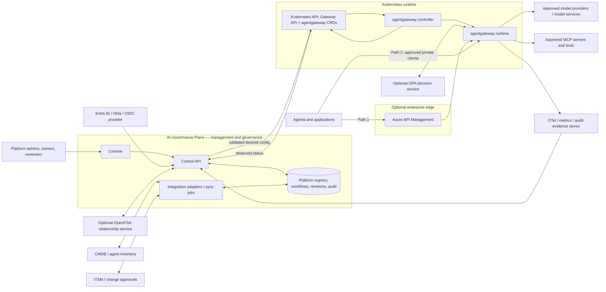
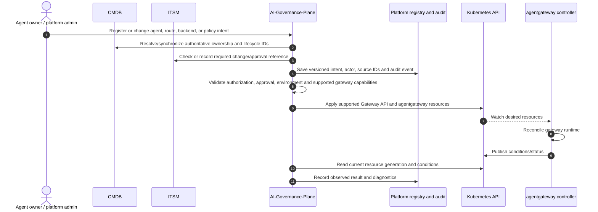

# AI Governance Plane Architecture

**Status:** Target architecture, with implementation status called out explicitly.
**Runtime boundary:** AI-Governance-Plane manages enterprise governance and desired configuration; agentgateway handles agent traffic.
**Current repository baseline:** agentgateway OSS v1.6.0 Kubernetes integration is represented in source, but live cluster and runtime compatibility are unverified. APIM ingress is a target path and is not currently implemented in this repository.

## 1. Architecture decision

AI-Governance-Plane sits beside agentgateway as the enterprise management and governance control plane. It owns governance workflows and a normalized view of enterprise resources; it does not sit in the synchronous inference path. agentgateway is the runtime gateway and enforcement point for supported request-time policies.

Two ingress paths are supported by the target architecture. Both converge on the same agentgateway-managed routes, backends, and minimum policy baseline:

1. APIM → agentgateway → approved model/MCP backends.
2. Approved private clients → agentgateway → those same backends.

The direct path is a controlled ingress option, not a route around gateway security. Neither APIM nor a client should be able to reach managed model/MCP backends through an alternate ungoverned route.

## 2. System context



OpenFGA and OPA are optional integrations, not implied dependencies. If used for request-time decisions, provide a supported runtime integration such as external authorization and define timeout/failure behavior. The control API may also use an authorization service for management actions; that is distinct from runtime enforcement.

## 3. Two agent-traffic paths

### Path 1 — APIM first hop

```text
Agent/application → APIM → agentgateway → approved model or MCP backend
```

Use this path for APIs that need APIM publication, API lifecycle/catalog integration, external or partner access, or enterprise edge controls. APIM can authenticate at the enterprise edge, apply coarse API-level limits and policies, and provide its portion of analytics. agentgateway then applies the common runtime identity, route, and AI/MCP-aware policies it supports.

Define one explicit identity contract. Depending on the chosen design, APIM may forward a validated caller token or exchange it for a gateway-facing token. The gateway must validate its configured issuer and audience and receive the identity/claims needed by runtime policy and audit. Do not trust caller-supplied identity headers unless APIM strips and securely replaces them over a protected hop.

### Path 2 — direct private ingress

```text
Approved private agent/application → agentgateway → approved model or MCP backend
```

Use this path for approved internal workloads when APIM is not required. Restrict network reachability to approved workloads and require agentgateway to enforce the same minimum runtime identity, authorization, routing, and logging baseline. A private network location alone is not authentication or authorization.

### Controls shared by both paths

- Both paths terminate at the same logical agentgateway routes and approved backend registry.
- Both use the same minimum gateway policy baseline, even if APIM adds extra edge policies on Path 1.
- Neither path exposes unrestricted direct network access to model providers or MCP servers.
- Define whether rate limits/quotas are enforced at APIM, agentgateway, or both; specify whether limits are additive or coordinated.
- Carry a stable request/correlation ID and trustworthy caller identity through each hop; prevent spoofing and record which ingress path was used.
- Export and correlate APIM and agentgateway telemetry. A trace observed at one layer does not prove telemetry exists at the other.
- Direct ingress must not be used to evade an approval, identity, data residency, or policy requirement imposed by enterprise governance.

## 4. Management and configuration flow



The platform must distinguish these states:

1. **Drafted:** intent exists in the management workflow.
2. **Approved:** required owner/security/ITSM approval is satisfied.
3. **Submitted:** Kubernetes accepted the write request.
4. **Observed:** the controller reports the current generation as accepted and its references resolve.
5. **Runtime verified:** a request-level integration check demonstrated the expected behavior.

Do not label a route or policy active based only on a successful write or the presence of a database record. Current repository status mappings treat controller conditions as evidence of observed resource state; real v1.6.0 cluster behavior remains unverified.

## 5. Sources of record and identity model

| Information | Source of record | Plane responsibility |
|---|---|---|
| Human authentication | Configured OIDC provider such as Entra ID or Okta | Validate issuer, audience, keys, and token; retain provider-neutral environment configuration and secret references. |
| Platform tenant membership and roles | AI-Governance-Plane authorization store, unless delegated to a selected external authorization system | Bind roles to stable identity `(issuer, subject)` and tenant; do not authorize from email or untrusted token role claims. |
| Agent/application ownership, business service and lifecycle | Enterprise CMDB/agent inventory | Synchronize or reference stable CMDB identifiers and expose a governed projection; clearly label locally managed exceptions. |
| Change tickets and enterprise approvals | ITSM where required by enterprise process | Link ticket IDs and decision evidence; prevent protected production changes until required approvals are met. |
| Active desired gateway resources | Kubernetes Gateway API and agentgateway CRDs managed by the platform | Validate, version, apply, and read back status. Avoid a competing active writer. |
| Observed gateway state | agentgateway controller conditions/status | Report accepted/rejected/pending separately from desired state. |
| Secrets | Enterprise secret manager; Kubernetes Secret as the runtime delivery mechanism where required | Keep plaintext out of platform records, logs, generated resource specs (except references), and audit details. |
| Runtime request evidence | Gateway/APIM telemetry and configured telemetry stores | Correlate gateway and APIM evidence; state explicitly when a signal is unavailable. |

Use environment variables for deployment bootstrap (database connection, OIDC bootstrap, cluster access, telemetry endpoints, and secret references). Use typed environment/integration records for multiple identity providers, ITSM/CMDB connections, and policy services. Avoid a growing flat collection of environment variables as the durable configuration database.

## 6. Policy model and enforcement

Policy records need a type, owner, version, scope, decision purpose, enforcement point, and evidence state. Environment configuration chooses enabled engines and connections; individual agent/environment assignments refer to the applicable versioned policies. Do not translate arbitrary source policies into gateway YAML and claim equivalence.

| Layer | Decision scope | Enforcement/evidence |
|---|---|---|
| Azure Policy | Azure resource/deployment compliance | Azure control plane and compliance state; not a per-request agent policy. |
| OpenFGA | Relationship checks such as team ownership or delegated administration | OpenFGA decision result at the management or supported runtime authorization point. |
| OPA | General-purpose decisions represented as Rego | OPA or a configured external decision integration; define availability and timeout behavior. |
| agentgateway native policies | Supported request-time gateway controls for routes, workload auth, rate limits, and supported LLM/MCP behaviors | Kubernetes resources reconciled by agentgateway; verify the precise behavior against the pinned release. |
| APIM policies | API edge controls on Path 1 | APIM runtime; complement the shared agentgateway baseline. |

Track policy lifecycle explicitly as configured → approved → published → controller accepted → runtime verified. If an engine is not integrated into the enforcement path, show it as informational or unenforced. In the current repository, MCP tool policy records are not published to or enforced by agentgateway, and budgets are advisory.

## 7. OpenAPI and MCP boundary

Upstream agentgateway documents OpenAPI-to-MCP support in standalone configuration. That does not prove the Kubernetes CRD surface targeted by this repository exposes the same integration. The current platform translator does not provide an OpenAPI-to-MCP intent model. Verify support against the exact Kubernetes CRD/controller release before adding a feature claim. Routing ordinary HTTP traffic to an OpenAPI service is not equivalent to exposing its operations as MCP tools.

MCP discovery is a management operation; an allowlist used by the control API is not an adequate runtime egress boundary. Apply network-level egress controls and verify that tool-level policy is enforced at the runtime before claiming it is active.

## 8. Environment configuration and release compatibility

Maintain an environment registry that describes:

- Environment and Kubernetes cluster/namespace.
- Exact agentgateway release and supported Gateway API/CRD capabilities.
- Enabled ingress paths and APIM instance/API references when applicable.
- OIDC providers, issuer/audience values, and client-secret references.
- CMDB and ITSM endpoints, sync scope, and credential references.
- OpenFGA/OPA/Azure integrations and the policy types they own.
- Secret-manager and telemetry endpoints, retention settings, and correlation requirements.

Keep secrets in a secret manager and pass references into generated resources where supported. Treat the pinned release as a compatibility target, not evidence. Validate generated resources against installed CRDs and controller status. The current code targets OSS v1.6.0 and uses Kubernetes as the configuration path; live resource acceptance and end-to-end request behavior remain unverified.

## 9. Current implementation versus target

| Capability | Repository evidence reviewed | Target / remaining gap |
|---|---|---|
| Management plane and registries | Control API and persistent workflow/registry source exists. | Production identity, CMDB/ITSM integration, and operational behavior need deployment validation. |
| Gateway configuration | Translator, Kubernetes client, and status reconciliation source exists. | Validate generated CRDs and status against a live pinned release. |
| Direct agentgateway ingress | Intended and documented request path; no inference proxy in the Control API. | Prove real gateway-to-deterministic-backend request and common policy enforcement. |
| APIM ingress | Not currently implemented in the repository. | Add APIM API/policy deployment and identity contract; test APIM → agentgateway end to end. |
| MCP | Registry and allowlisted discovery source exists. | Publish and enforce tool policies at runtime; prove egress controls. |
| Policy integrations | Gateway policy translation source exists for supported subset. | No blanket OpenFGA/OPA/Azure Policy translation. Add explicit adapters and enforcement semantics per decision type. |
| Telemetry and budgets | Control-plane telemetry readers and budget records exist. | Verify gateway/APIM signals and correlate usage; budget enforcement is not currently established. |

See [initial observations](initial_observations.md), [system overview](../ai-platform/docs/architecture/system-overview.md), and [MVP scope](../ai-platform/docs/architecture/mvp-scope.md) for findings and implementation limits.
