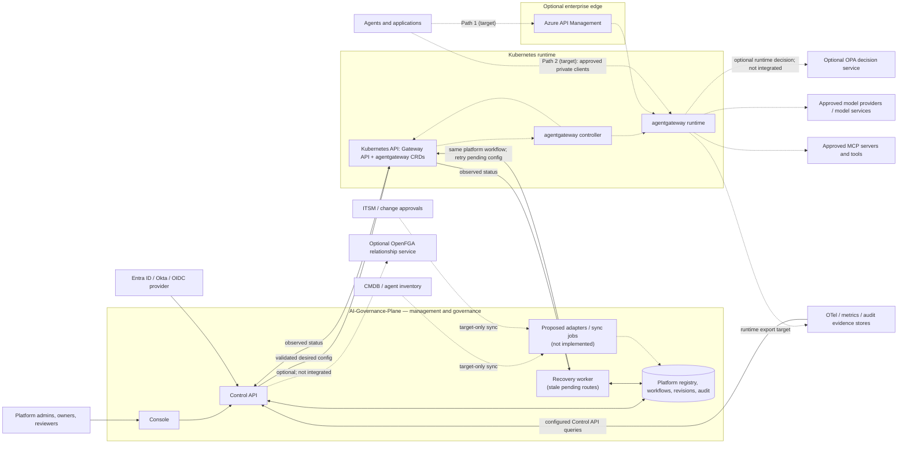
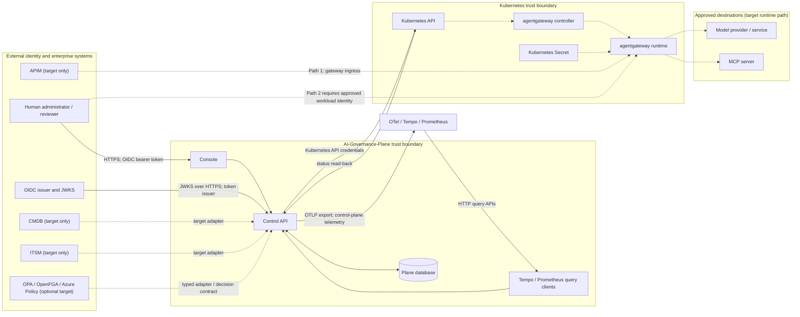
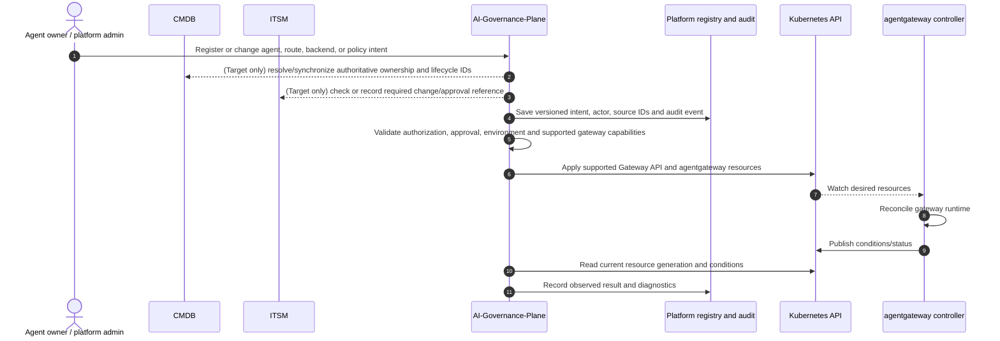
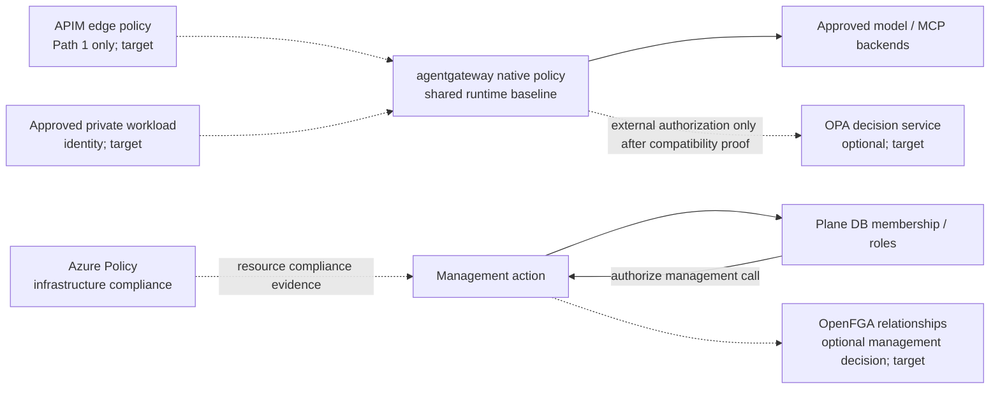

# AI Governance Plane Architecture

**Status:** Target architecture, with implementation status called out explicitly.
**Runtime boundary:** AI-Governance-Plane manages enterprise governance and desired configuration; agentgateway handles agent traffic.
**Current repository baseline:** agentgateway OSS v1.6.0 Kubernetes integration is represented in source, but live cluster and runtime compatibility are unverified. APIM ingress is a target path and is not currently implemented in this repository.

## 1. Architecture decision

AI-Governance-Plane sits beside agentgateway as the enterprise management and governance control plane. It owns governance workflows and a normalized view of enterprise resources; it does not sit in the synchronous inference path. agentgateway is the runtime gateway and enforcement point for supported request-time policies.

Two ingress paths are supported by the target architecture. Both converge on the same agentgateway-managed routes, backends, and minimum policy baseline:

1. APIM → agentgateway → approved model/MCP backends.
2. Approved private clients → agentgateway → those same backends.

The direct path is a controlled ingress option, not a route around gateway security. Neither APIM nor a client should be able to reach managed model/MCP backends through an alternate ungoverned route.

## 2. System context



Solid lines represent source-backed paths; dashed lines represent target-only paths. OpenFGA and OPA are optional integrations, not implied dependencies. If used for request-time decisions, provide a supported runtime integration such as external authorization and define timeout/failure behavior. The control API may also use an authorization service for management actions; that is distinct from runtime enforcement.

### Trust boundaries



The Control API is not a network hop for model or MCP requests. The repository does not configure a public/edge TLS termination policy, direct-private workload identity, APIM, CMDB, ITSM, network policies, or gateway runtime egress controls; these remain deployment requirements, not properties guaranteed by the source.

## 3. Two agent-traffic paths

### Path 1 — APIM first hop

```text
Agent/application → APIM → agentgateway → approved model or MCP backend
```

Use this path for APIs that need APIM publication, API lifecycle/catalog integration, external or partner access, or enterprise edge controls. APIM can authenticate at the enterprise edge, apply coarse API-level limits and policies, and provide its portion of analytics. agentgateway then applies the common runtime identity, route, and AI/MCP-aware policies it supports.

Define one explicit identity contract. Depending on the chosen design, APIM may forward a validated caller token or exchange it for a gateway-facing token. The gateway must validate its configured issuer and audience and receive the identity/claims needed by runtime policy and audit. Do not trust caller-supplied identity headers unless APIM strips and securely replaces them over a protected hop.

### Path 2 — direct private ingress

```text
Approved private agent/application → agentgateway → approved model or MCP backend
```

Use this path for approved internal workloads when APIM is not required. Restrict network reachability to approved workloads and require agentgateway to enforce the same minimum runtime identity, authorization, routing, and logging baseline. A private network location alone is not authentication or authorization.

### Controls shared by both paths

- Both paths terminate at the same logical agentgateway routes and approved backend registry.
- Both use the same minimum gateway policy baseline, even if APIM adds extra edge policies on Path 1.
- Neither path exposes unrestricted direct network access to model providers or MCP servers.
- Define whether rate limits/quotas are enforced at APIM, agentgateway, or both; specify whether limits are additive or coordinated.
- Carry a stable request/correlation ID and trustworthy caller identity through each hop; prevent spoofing and record which ingress path was used.
- Export and correlate APIM and agentgateway telemetry. A trace observed at one layer does not prove telemetry exists at the other.
- Direct ingress must not be used to evade an approval, identity, data residency, or policy requirement imposed by enterprise governance.

## 4. Management and configuration flow



CMDB and ITSM steps above describe target interactions; no such adapters or sync jobs exist in the current source.
The API currently applies and reads status synchronously. A separate database-backed worker retries stale pending route revisions through the same translator/Kubernetes client; it is a recovery component of the Plane, not an independent source of desired state.

The platform must distinguish these states:

1. **Drafted:** intent exists in the management workflow.
2. **Approved:** required owner/security/ITSM approval is satisfied.
3. **Submitted:** Kubernetes accepted the write request.
4. **Controller accepted:** current-generation controller conditions report acceptance and route references resolve.
5. **Runtime verified:** a request-level integration check demonstrated the expected behavior.

Do not label a route or policy active based only on a successful write or the presence of a database record. The source requires current-generation controller conditions and matching route/policy revision labels for `observed_active`; that is controller-observed state, not runtime verification. Live v1.6.0 behavior remains unverified.

## 5. Sources of record and identity model

| Information | Source of record | Plane responsibility |
|---|---|---|
| Human authentication | Configured OIDC provider such as Entra ID or Okta | Validate issuer, audience, keys, and token; retain provider-neutral environment configuration and secret references. |
| Platform tenant membership and roles | AI-Governance-Plane authorization store, unless delegated to a selected external authorization system | Bind roles to stable identity `(issuer, subject)` and tenant; do not authorize from email or untrusted token role claims. |
| Agent/application ownership, business service and lifecycle | Enterprise CMDB/agent inventory | Synchronize or reference stable CMDB identifiers and expose a governed projection; clearly label locally managed exceptions. |
| Change tickets and enterprise approvals | ITSM where required by enterprise process | Link ticket IDs and decision evidence; prevent protected production changes until required approvals are met. |
| Active desired gateway resources | Kubernetes Gateway API and agentgateway CRDs managed by the platform | Validate, version, apply, and read back status. Avoid a competing active writer. |
| Observed gateway state | agentgateway controller conditions/status | Report accepted/rejected/pending separately from desired state. |
| Secrets | Enterprise secret manager; Kubernetes Secret as the runtime delivery mechanism where required | Keep plaintext out of platform records, logs, generated resource specs (except references), and audit details. |
| Runtime request evidence | Gateway/APIM telemetry and configured telemetry stores | Correlate gateway and APIM evidence; state explicitly when a signal is unavailable. |

Use environment variables for deployment bootstrap (database connection, OIDC bootstrap, cluster access, telemetry endpoints, and secret references). Use typed environment/integration records for multiple identity providers, ITSM/CMDB connections, and policy services. Avoid a growing flat collection of environment variables as the durable configuration database.

## 6. Policy model and enforcement

Policy records need a type, owner, version, scope, decision purpose, enforcement point, and evidence state. Environment configuration chooses enabled engines and connections; individual agent/environment assignments refer to the applicable versioned policies. Do not translate arbitrary source policies into gateway YAML and claim equivalence.

| Layer | Decision scope | Enforcement/evidence |
|---|---|---|
| Azure Policy | Azure resource/deployment compliance | Azure control plane and compliance state; not a per-request agent policy. |
| OpenFGA | Relationship checks such as team ownership or delegated administration | OpenFGA decision result at the management or supported runtime authorization point. |
| OPA | General-purpose decisions represented as Rego | OPA or a configured external decision integration; define availability and timeout behavior. |
| agentgateway native policies | Supported request-time gateway controls for routes, workload auth, rate limits, and supported LLM/MCP behaviors | Kubernetes resources reconciled by agentgateway; verify the precise behavior against the pinned release. |
| APIM policies | API edge controls on Path 1 | APIM runtime; complement the shared agentgateway baseline. |



Track policy lifecycle explicitly as configured → approved → published → controller accepted → runtime verified. If an engine is not integrated into the enforcement path, show it as informational or unenforced. In the current repository, MCP tool policy records are not published to or enforced by agentgateway, and budgets are advisory.

## 7. OpenAPI and MCP boundary

Upstream agentgateway documents OpenAPI-to-MCP support in standalone configuration. That does not prove the Kubernetes CRD surface targeted by this repository exposes the same integration. The current platform translator does not provide an OpenAPI-to-MCP intent model. Verify support against the exact Kubernetes CRD/controller release before adding a feature claim. Routing ordinary HTTP traffic to an OpenAPI service is not equivalent to exposing its operations as MCP tools.

MCP discovery is a management operation; an allowlist used by the control API is not an adequate runtime egress boundary. Apply network-level egress controls and verify that tool-level policy is enforced at the runtime before claiming it is active.

## 8. Environment configuration and release compatibility

Use a provider-neutral, validated environment record rather than adding one-off variables for each enterprise product. The following is a target schema, not a record currently persisted by this repository:

```yaml
environmentId: prod-us
clusterRef: cluster/prod-us
gateway:
  namespace: agentgateway-system
  release: v1.6.0
  apiCapabilities: [HTTPRoute, AgentgatewayBackend, AgentgatewayPolicy]
ingress:
  directPrivate:
    enabled: true
    workloadIdentityProfileRef: identity/private-workloads
    networkPolicyRef: netpol/approved-agents
  apim:
    enabled: false
    instanceRef: null
    identityContractRef: null
identityProviders:
  - issuer: https://id.example.com/
    audience: ai-governance-api
    clientId: ai-governance-control-api
    jwksOrDiscoveryRef: oidc/primary
integrations:
  cmdb: {type: cmdb, endpointRef: integration/cmdb, credentialRef: secret/cmdb}
  itsm: {type: itsm, endpointRef: integration/itsm, credentialRef: secret/itsm}
  policyEngines:
    - type: opa
      endpointRef: integration/opa
      enforcementPoint: agentgateway-external-auth
      timeoutMs: 200
      failureMode: closed
telemetry:
  tracesRef: telemetry/otlp-traces
  metricsRef: telemetry/otlp-metrics
  retentionRef: retention/runtime-audit
secretManagerRef: secrets/enterprise
```

Values ending in `Ref` are identifiers to managed configuration/secret records, never plaintext credentials. The contract must validate each integration type, endpoint, ownership, scope, and failure behavior; an adapter must reject unsupported combinations rather than treating every engine as generic policy YAML.

The record should describe:

- Environment and Kubernetes cluster/namespace.
- Exact agentgateway release and supported Gateway API/CRD capabilities.
- Enabled ingress paths and APIM instance/API references when applicable.
- OIDC providers, issuer/audience values, and client-secret references.
- CMDB and ITSM endpoints, sync scope, and credential references.
- OpenFGA/OPA/Azure integrations and the policy types they own.
- Secret-manager and telemetry endpoints, retention settings, and correlation requirements.

Keep secrets in a secret manager and pass references into generated resources where supported. The current source does not persist this environment/integration registry: OIDC, Kubernetes target, telemetry URLs, and MCP host allowlist are environment bootstrap configuration; provider credentials are referenced as Kubernetes Secrets. Treat the pinned release as a compatibility target, not evidence. Validate generated resources against installed CRDs and controller status. The current code targets OSS v1.6.0 and uses Kubernetes as the configuration path; live resource acceptance and end-to-end request behavior remain unverified.

## 9. Boundary and integration matrix

Status terms: **implemented** means the source contains the integration behavior; **partial** means only a management/configuration slice exists and important enforcement or lifecycle behavior is absent; **configured-but-unverified** means code/configuration exists but the external service or live behavior has not been tested; **target-only** means there is no current integration in this repository.

| Boundary; owner | Direction and protocol | Authentication / authorization | Data exchanged and trust handling | Status | Failure behavior |
|---|---|---|---|---|---|
| Administrator/reviewer → Console and Control API; Plane | Browser to static Console and REST API over HTTP(S) deployment ingress | Bearer OIDC JWT; API verifies issuer/audience/signature and resolves roles from `(issuer, subject, tenant)` memberships. `X-Tenant-ID` selects context only after membership/admin authorization. | Validated management payloads; response includes correlation ID. Do not use email, caller role claims, or tenant headers as authority. Repo does not define TLS termination or edge rate limits. | **configured-but-unverified**; source routes/auth are present, production ingress is not verified | Authentication/authorization and input errors reject the request; dependency failures should remain errors, not success-shaped state. |
| OIDC provider → Control API; IdP | API fetches JWKS via HTTPS; caller presents bearer token | Token signature, issuer, audience, expiry and required claims checked; JWKS timeout bounded | Signing keys and identity claims only; identity key is `(issuer, subject)`. No provider client secret is currently required for this API validation flow. | **configured-but-unverified**; single/multi-issuer configuration supported in source, provider interoperability not tested | Unknown issuer, invalid token, or unavailable keys fail closed with authentication error. |
| Control API ↔ Plane database; Plane | SQL over configured `DATABASE_URL` | Database credentials from deployment configuration/secret; tenant-scoped SQL queries | Memberships, application/model/route records, workflows, policy revision snapshots, and audit chain. Database is authoritative for Plane-owned membership/role records, not CMDB/ITSM truth. | **configured-but-unverified**; ORM and migrations exist, production PostgreSQL migration not run | Readiness returns 503 on failed DB check; request/transaction failure is surfaced. |
| Control API → Kubernetes API; Plane | Kubernetes API HTTPS; server-side apply patch and resource GET | In-cluster service-account credentials; namespace-scoped Role/RoleBinding in checked-in manifests | Validated HTTPRoute/AgentgatewayBackend/AgentgatewayPolicy and key catalog ConfigMap; revision/tenant labels; status conditions read back. No second writer is specified. | **configured-but-unverified**; client, translator, and RBAC source exist; live CRDs/controller not tested | Kubernetes errors are explicit; apply failure is marked failed, missing/insufficient status remains pending, rejected conditions remain rejected. |
| agentgateway controller ↔ Kubernetes API; Gateway operator | Kubernetes watch/reconcile/status API | Controller's Kubernetes identity/RBAC; installation managed outside this repository | Resource generation, conditions, resolved references; status alone is controller observation, not proof of request-level runtime behavior. | **target-only / externally installed**; platform read-back exists but deployment is not included | Controller/API outage leaves desired resource unobserved; Plane must show pending/unavailable, not active. |
| Agent/application → APIM → agentgateway; APIM and Gateway | Runtime HTTPS ingress | Token forwarding or exchange must be explicitly selected; both hops validate appropriate issuer/audience and prevent spoofed identity headers | Request identity, API request, trusted correlation ID, ingress-path marker; APIM policies end at edge, shared runtime baseline begins at agentgateway. | **target-only**; no APIM deployment, identity bridge, or test exists | Reject when either hop cannot authenticate/authorize; do not silently fall through to private ingress. |
| Approved private workload → agentgateway; workload platform and Gateway | Private-network HTTPS ingress | Workload identity plus gateway-side authentication/authorization; network reachability is an additional restriction, not identity | Same logical routes, backends, and minimum policy baseline as APIM path; no direct backend access. | **target-only**; no private workload identity or network policy is configured here | Deny unauthenticated/unapproved workloads; gateway unavailability fails the request. |
| agentgateway → model provider/service; Gateway and provider | Runtime provider protocol over egress network | Provider credential referenced as Kubernetes Secret by generated backend; actual gateway resolution is unverified | Approved model/backend ID, prompts and completions; data residency, retention, egress allowlists, timeout/retry policy require runtime configuration and proof. | **configured-but-unverified** for emitted backend resources; inference path is not implemented by the Plane or tested end to end | Provider failures/timeouts must be surfaced by gateway; retry behavior must be bounded and idempotency-aware (not established by this repo). |
| Control API → MCP endpoint (discovery); Plane and MCP owner | Outbound HTTPS JSON-RPC `initialize`, notification, and `tools/list`; 8-second client timeout, redirects disabled | Exact hostname allowlist via `MCP_ALLOWED_HOSTS`; this does not pin DNS or block private IPs and does not configure endpoint authentication | Tool names, descriptions and schemas; newly discovered tools are sensitive and approval-required by default. Discovery does not authorize runtime invocations. | **partial**; bounded source implementation exists; SSRF/DNS-rebinding and network egress controls are missing | HTTP/JSON-RPC/schema errors are surfaced; stored discovery snapshot remains unchanged on failed call. |
| agentgateway → MCP server/tool; Gateway and server owner | Runtime MCP transport/protocol | Must use gateway-supported workload/tool auth and per-tool policy; no enforcement integration is currently emitted by this Plane | Tool calls and results may contain sensitive data; registry allowlist is not a runtime egress control. | **target-only** for Plane-managed policy; tool policies are explicitly `not_published_to_gateway` | Runtime denial/timeout policy depends on gateway configuration and has not been verified. |
| Control API ↔ CMDB and ITSM; enterprise system owners | Future API/webhook/scheduled sync; protocol and cadence to be selected | Per-integration service identity and scoped credentials via secret references | CMDB owns external app/agent ID, owner/team, service, environment, lifecycle; ITSM owns ticket/decision. Plane stores references/projections; source wins conflicts. | **target-only**; no adapters or sync jobs | Required production gate fails closed if mandatory source unavailable; read-only pages should label stale/unavailable projections. No sync conflict behavior exists yet. |
| Plane ↔ OpenFGA / OPA / Azure Policy; respective policy owners | Typed API/decision interface, selected per engine | Workload identity and least-privilege engine credentials; never exchange arbitrary policy text as if equivalent | OpenFGA relationships; OPA decisions/bundles; Azure deployment compliance. Azure Policy is not request authorization. | **target-only**; no adapter is wired | Decision timeout/failure mode must be explicit per policy contract. Runtime `fail-closed` for required access checks; Azure compliance cannot substitute for runtime decisions. |
| Secret manager → Kubernetes Secret → agentgateway; secret owner and runtime operator | Secret-manager delivery mechanism is deployment-specific; Gateway reads Kubernetes Secret through supported reference | Secret-manager workload identity and namespace-scoped Secret RBAC | Plaintext provider credential only in approved secret store/runtime secret; Plane records reference, never value. Vault adapter in source formats references only. | **partial**; translator uses Secret reference; secret-manager synchronization/resolution is not implemented | Missing/invalid Secret must prevent backend readiness; never expose the value in API, logs, or audit. |
| Control API → OTel; Plane | OTLP/HTTP traces and metrics | No exporter auth mechanism is configured in source; secure endpoint/network credentials must be deployment-provided | Control API spans and request counts; method/status and tenant attribute, not request bodies. Not gateway token usage. | **configured-but-unverified**; source/configuration exists, export receipt not proved | Production startup requires exporter endpoints; query/export failure must be shown unavailable and must not synthesize gateway evidence. |
| Control API ↔ Tempo/Prometheus; observability operators | HTTP query APIs | Endpoint auth/TLS is not configured in source; secure network deployment required | Tenant-filtered traces and configured tenant-scoped metrics; gateway/token/cost queries unavailable unless explicitly configured and emitted. | **configured-but-unverified** for API queries; gateway runtime signals are **target-only** | Missing endpoints/query templates produce explicit unavailable/error results; no zero-valued compliance or usage fallback. |
| Plane audit → Plane database; Plane | SQL transaction; no external anchor | Tenant authorization on reads/writes | Actor, action, resource, payload hash and chained event hash. This is tamper-evident application storage, not WORM/immutable evidence. | **implemented** in source; external retention/anchoring is **target-only** | Transaction errors fail the operation; external backup, retention, and tamper-resistant anchoring remain deployment controls. |

The current API request correlation ID is generated or accepted at the Control API and returned to its caller; source does not yet demonstrate end-to-end propagation to APIM, gateway runtime records, Kubernetes resources, or model/MCP backends. Do not claim a correlated cross-plane trace until that is verified.

## 10. Current implementation versus target

| Capability | Repository evidence reviewed | Target / remaining gap |
|---|---|---|
| Management plane and registries | Control API and persistent workflow/registry source exists. | Production identity, CMDB/ITSM integration, and operational behavior need deployment validation. |
| Gateway configuration | Translator, Kubernetes client, and status reconciliation source exists. | Validate generated CRDs and status against a live pinned release. |
| Direct agentgateway ingress | Intended and documented request path; no inference proxy in the Control API. | Prove real gateway-to-deterministic-backend request and common policy enforcement. |
| APIM ingress | Not currently implemented in the repository. | Add APIM API/policy deployment and identity contract; test APIM → agentgateway end to end. |
| MCP | Registry and allowlisted discovery source exists. | Publish and enforce tool policies at runtime; prove egress controls. |
| Policy integrations | Gateway policy translation source exists for supported subset. | No blanket OpenFGA/OPA/Azure Policy translation. Add explicit adapters and enforcement semantics per decision type. |
| Telemetry and budgets | Control-plane telemetry readers and budget records exist. | Verify gateway/APIM signals and correlate usage; budget enforcement is not currently established. |

See [initial observations](initial_observations.md), [system overview](../ai-platform/docs/architecture/system-overview.md), and [MVP scope](../ai-platform/docs/architecture/mvp-scope.md) for findings and implementation limits.
